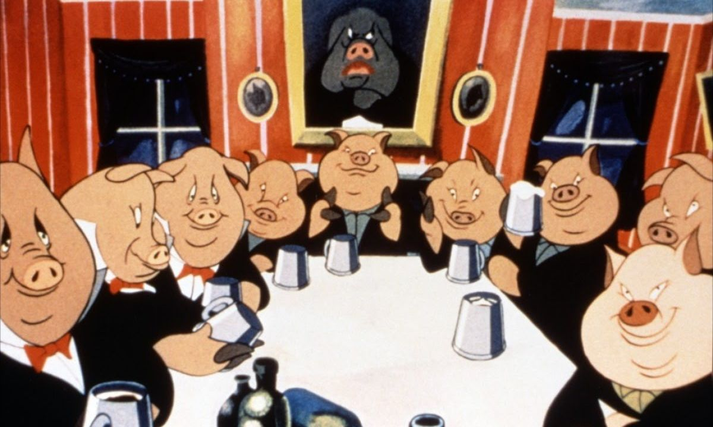
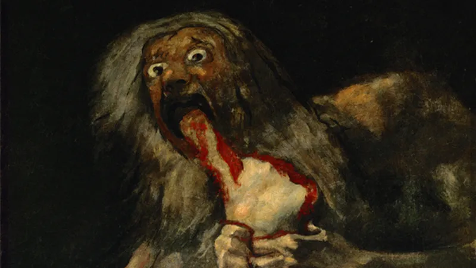

# Ženstvenost totalitarizma

{ .image-hero }

2015\. je godine ljubljanski art-rock band [Laibach](https://hr.wikipedia.org/wiki/Laibach) ostvario jedinstveni uspjeh i presedan: postao je prvi Zapadnjački bend pozvan da održi koncert u Sjevernoj Koreji povodom Dana oslobođenja. Nedugo zatim, slovenski filozof [Slavoj Žižek](https://hr.wikipedia.org/wiki/Slavoj_%C5%BDi%C5%BEek) daje [uvod dokumentarcu "Liberation day"](https://www.youtube.com/watch?v=NRfgKrmI9Po). U tom uvodu, na njemu svojstven način, Žižek konstatira kako je "pravi totalitaristički režim u strukturi majčinski sustav, a ne strogo, očinsko, displinarno tijelo".

<!-- more -->

Totalitarizam je politički ustroj u kojemu država teži ka uništenju pojedinačne slobode te podčinjavanju svih pojedinčevih težnji i želja autoritetu vlade. Zašto bi on u svojoj strukturi bio majčinski?

Valja reći odmah na početku da se ovdje radi o simboličkom izražavanju. Intelektualno jednostavne i nepromišljenje osobe ponekad zapadaju u zamku poistovjećivanja Ženstvenog sa ženama i Muževnog sa muškarcima. Potpuno bi objašnjenje upotrebe ovih pojmova zahtijevalo vlastitu objavu, tako da ćemo se zadovoljiti kratkom opaskom. Kada se ljudska psiha prvi puta susretne sa svijetom, ona čini primordijalnu diferencijaciju istog na najjednostavniji način: siječući ga na dva, istom tako stvarajući dvije masivne mentalne kategorije. Kako imenovati te kategorije? Po svoj prilici priljepljujući im imena prva dva neposredno smislena fenomena, Majke i Oca, odnosno Muževnog i Ženstvenog. Kasniji fenomeni mogu onda biti kategorizirani kao primarno Muževni ili primarno Ženstveni. Muževno je često ono šta probija, zrači, ističe se, raste uvis i sjaji, dok je Ženstveno često ono šta obavija, zaprima, daje pozadinu, raste u širinu i grije. Svaki fenomen participira u oba principa sebi svojstvenim proporcijama.

Totalitarizam  je simbolički Ženstveno poređenje zbog načina na koji stupa u odnos sa pojedinčevom voljom.

Za [Hirohitov](https://hr.wikipedia.org/wiki/Hirohito) Imperijalni Japan, efektivno monarhiju, možemo sa sigurnošću reći da je bio krajnje patrijarhalan. U uvodu knjige Silovanje Nankinga[^1][^2] autorica Iris Chang britko objašnjava odnos običnog japanca i cara. Vrijednost ljudske duše, japanske i onkraj, je isijavala iz samog cara, i nju su uživali tim više oni koji su caru bili bliži. Car se nalazio na vrhuncu hijerarhije vrijednosti zato jer je on bio car, ona mu je bila svojstvena i neupitna. Kada je valjalo ići u rat, polazilo se zato jer je to car odredio i preispitivanje odredbe je bilo gore od bogohuljenja. Pojedinčeva je volja bila zanemarivana i umanjivanja da gotovog nestajanja, ali postojalo je implicitno priznanje da ona postoji i da se možebit čak razlikuje od careve. Situacija se razrješavala tako da se u japanski narod od malena ubijala poruka da su oni ništavni spram cara te da im valja bespogovorno slušati. Ti ratuješ za cara.
Ako bi u jednu rečenicu saželi poruku Imperijalnog Japana vlastitim vojnicima pri polasku u rat, ona bi bila "Ne zanima me i nije bitno želiš li ili ne želiš učiniti šta ti mi govorimo, ima ti poći zato jer smo mi tako rekli." To je geslo arhetipa Proždrljivog oca.

Totalitarizam je boljka 20. stoljeća. Opće je poznato da je Orwellova *Životinjska farma*[^3] odličan alegorijski prikaz razvoja totalitarizma od pridobivanja većine pučanstva (mahom radnika) obećanjima dobrobiti, preko učvršćivanja vladavine propagandom, pa sve do željeznog, despotskog stiska. Njegova je priča direktna alegorija na razvoj Sovjetskog saveza gdje Old Major, Snowball i Napoleon redom predstavljaju Lenina/Marxa, Trotskog i Staljina. Usprkos tome, alegorija se može primijeniti i na druge europske totalitarističke režime, pa ćemo ju ovdje iskoristiti kao kostur kako bi u kratkim crtama prikazali šta mislimo kad kažemo da je totalitarizam simbolično Ženstven.

Sjeme okrutne totalitarne vlasti nije displina, niti snaga, niti čast, već empatija. Počinje majčinskim razumijevanjem da nam je netko učinio nažao, prevario nas, oduzeo nam nešto, i potporom da se to treba povratiti pošto poto, _makar nasilno_. Kasnije će se ispostaviti da se ovim moralnim gambitom normalizira nasilna intervencija u okviru novonastalog političkog režima. Stabilizaciju poređenja prati propaganda. Govori se o boljitku, uvjerava se da "Majka Država" pruža blagodati dotada nečuvene. U Životinjskoj se farmi govori o usjevima kakvi se nisu vidjeli godinama, a pripisuju se novonastaloom režimu. 

U ovom se trenutku događa ključni preokret u odnosu totalitarističkog režima i pojedinca. Režim se izjednačava sa utopijom ostvarenom imajući u cilju isključivo dobro pojedinca. Usto se plasira ideja kako režim ne samo zna rješiti probleme pojedinca, već da ih je već i rješio. Odjednom težnje i odluke totalitarističkog režima postaju nepreispitive, ali iz razloga koji se razlikuje od primjera sa Imperijanim Japanom. Ovdje poslušnost nije potrebna. Slaganje je implicirano jer smo na ishodištu prihvatili da je funkcija režima u našem najboljem interesu.

/// caption
*Saturn proždire svoga sina*, Francisco Goya (1821-23). Izvor: [Britannica](https://www.britannica.com/topic/Saturn-painting-by-Goya).
///

Disidencija tada postaje čin nasilja i sama vrijedna nasilne odmazde - tobože ne zato jer se opire režimu, već zato jer sami stajemo na put vlastitom boljitku. Ima li ičeg odvratnijeg od izdaje majke koja je sebe cijelu dala za nas? Količina empatije i apsolutna posvećenost koje su nam ukazane na početku kako bi nas se izbavilo iz sužanjstva zahtijeva odgovor jednakom odanošću. Bilo koji čin otpora sada postaje razlog potpunog i neopozivog prestanka ukazivanja milosti. Tako volja dobrog pojedinca postaje istovjetna sa voljom Partije, a pojedinac koji se ne slaže sa tom voljom je jedinka tako korumpirana i do srži pokvarena da je u sukobu sa samim sobom, te ga stoga, pomoću presedana nasilja, treba eliminirati prije nego kontaminira i zbuni ostale.

Totalitarizam je dakle simbolički Ženstven zato jer polazi iz instrumentalizirane empatije (umjesto časti ili dužnosti - tipično instrumentaliziranih u Muževnim opresivnim režimima, e.g. Imperijalnog Japana) kako bi zadobio potporu. Nakon toga se izjednačava sa dobrom definirajući ga kao "dobro za podanike samog režima" (umjesto kao nekog apstraktnog, metafizičkog ili apsolutnog Dobra kao kod Muževnih opresivnih režima - e.g. Crkvene inkvizicije). Ono se definira kao entitet koji se potpuno stavio u našu službu, koji stremi ka onome najboljem za nas čak (ili _pogotovo_) kada mi ne znamo šta je to. I na kraju, odmazda je opravdana i nužna u slučaju neslaganja, ne zato jer se radi o otporu režimu kao takvom - ono za sebe ne mari i stalo mu je samo do nas - već zato jer je ugrožavanje tog režima koji postoji isključivo u službi podanika prijetnja ostatku mladunčadi koju pod svaku cijenu valja zaštititi, makar potapanja zakržljalih ne bi li ovi svojom slabošću doveli u opasnost ostatak legla.

[^1]: I. Chang: _The Rape of Nanking_ (hrv. Silovanje Nankinga), 1997.
[^2]: [Nankinški masakr](https://en.wikipedia.org/wiki/Nanjing_Massacre) se odnosi na agresiju počinjenu između prosinca 1937. i ožujka 1938. godine u kineskom gradu Nankingu od strane Japanske Imperijalne vojske. Procjenjuje se da je ubijeno između 150 i 350 tisuća kineskih civila. Autorica Iris Chang događaj naziva i Drugim Holokaustom.
[^3]: G. Orwell: *Animal Farm* (hrv. Životinjska farma), 1945. 
